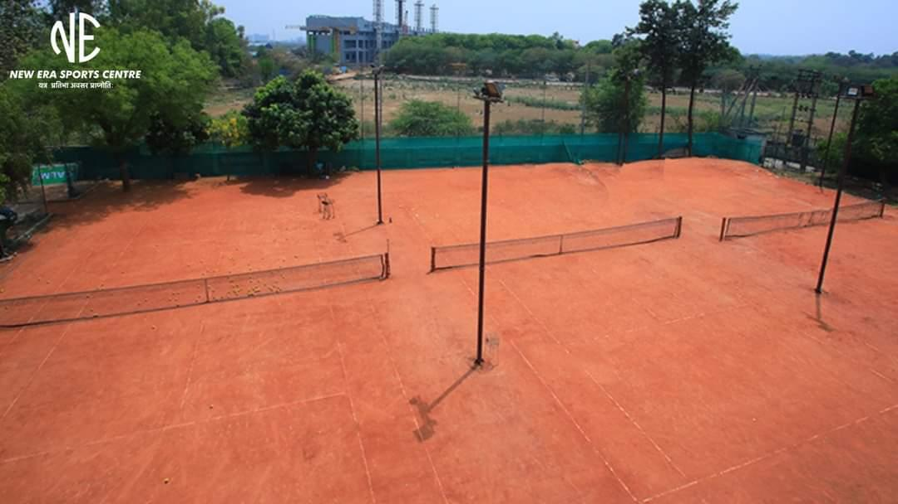

Ask parents what they want from a school and most will start with academics. Ask them what they remember from their own school days, and the answer is often a match, a team or a coach. Sport stays with children because it asks something of them that a textbook can't.

When you compare schools in Dwarka, it helps to look past the word "sports" in a brochure. A painted court and a weekly games period is one thing. Daily coaching on proper facilities is another.

## What sport teaches that a classroom can't

A child in a team learns quickly that effort is shared. You can't pass a ball to yourself, and you can't win a relay alone. Team spirit is learned by practising it, not by hearing about it.

Sport also gives children a safe way to lose. A lost match stings, and then there is practice the next morning. That cycle of trying, failing and trying again builds resilience, which is exactly what children need later in exams and in life.

> A lost match stings, and then there is practice the next morning.

Finally, sport gives energy somewhere to go. Active children get to know their own strengths, and many grow in confidence once they find something they are good at.

## Why a shooting range?

Shooting looks like the opposite of a team game, and that is what makes it useful. It rewards stillness, breathing and focus. A shooter has only one thing to control: themselves. For a quiet child who doesn't enjoy contact sports, it can be the sport that finally fits.

New Era's Sports Centre has a 10 metre rifle and pistol range indoors, used under the guidance of a coach.

## Inside the New Era Sports Centre

The centre sits on the school's 5-acre campus in Sector 25, Dwarka. It was set up with a simple aim: to give children the right facilities, in the right place, to develop their talent.

- **Outdoor:** cricket field and two nets, basketball court, football field, three clay courts for lawn tennis, and a pickleball court opened in August 2026
- **Indoor:** shooting range, table tennis hall and gymnasium
- **Also on offer:** skating, yoga and Zumba

Programmes run at beginner, intermediate and elite levels, so a child can start from zero or train seriously. Students have represented the school at State and National level in sports including lawn tennis, shooting and gymnastics. [Meet the coaches](sports-centre.html).

## Five questions to ask on a school visit

1. Which sports have a dedicated coach?
2. When do children train: during school, before it or after it?
3. Can a beginner join, or only children who already play?
4. Are the facilities on campus, or do children travel?
5. What do children do on days when the air quality is poor?

A good school will answer all five plainly, and will be happy to show you around while it does.
